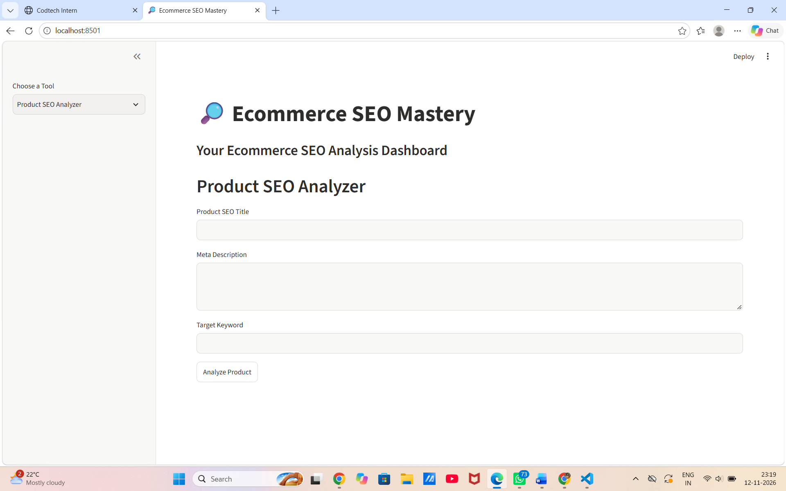

# Ecommerce SEO Mastery

## About the Project
Ecommerce SEO Mastery is an interactive digital marketing project developed using Python and Streamlit. It helps ecommerce businesses analyze website SEO performance and improve their online visibility.

## Features
- Website SEO Audit
- Product SEO Analyzer
- Keyword Research Tool
- SEO Score Analysis
- SEO Improvement Suggestions
- Downloadable CSV Reports

## Technologies Used
- Python
- Streamlit
- Pandas
- BeautifulSoup
- Requests
- Plotly

## Project Objective
The main objective is to understand and implement ecommerce SEO techniques, analyze website performance, optimize product pages, and improve search engine visibility.

## How to Run the Project
1. Install Python.
2. Install the required libraries using `pip install -r requirements.txt`.
3. Run `python -m streamlit run app.py`.
4. Open the local URL displayed in the terminal.

## Author
Github Marketing Internship Project

## 📸 Project Screenshots

The following screenshots showcase the different features and functionalities of the Ecommerce SEO Mastery dashboard. They demonstrate how users can analyze website SEO performance, optimize ecommerce product listings, generate keyword ideas, and view SEO recommendations through an interactive and user-friendly interface.

### 1. Dashboard

### 2. Website SEO Audit

### 3. Product SEO Analyzer

### 4. Keyword Research

